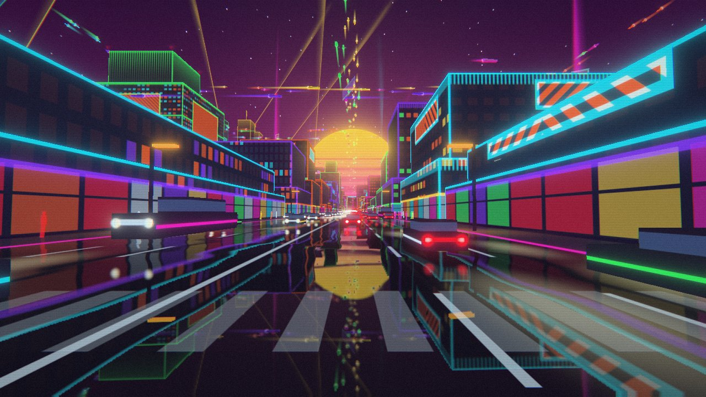
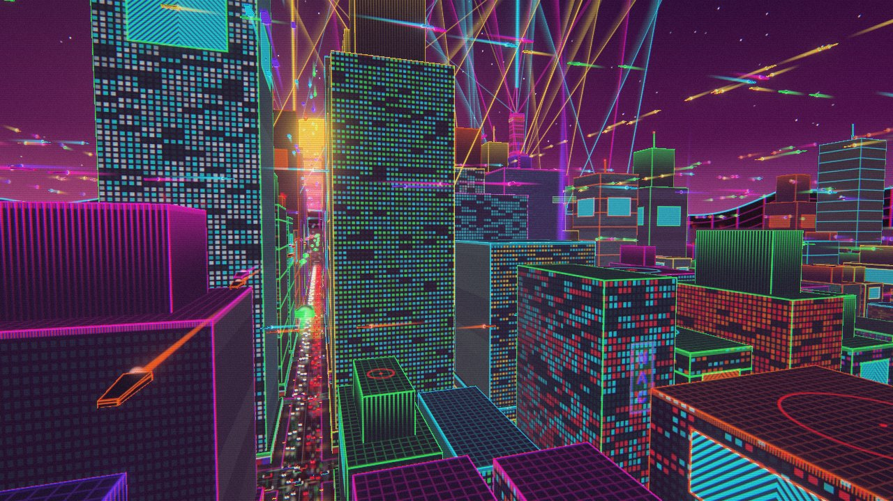
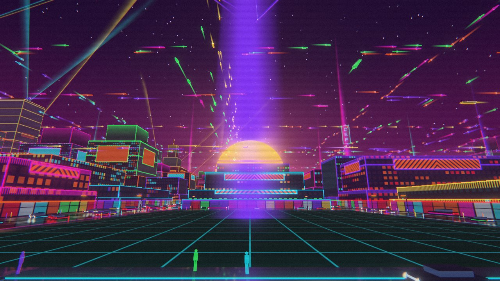
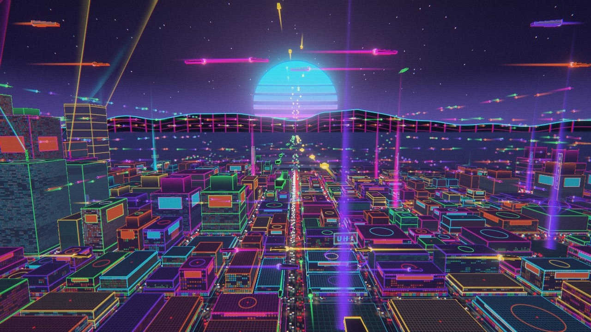

# Synthwave City 64k

An endless synthwave megacity you fly through, in **one HTML file of 17,146 bytes**. Neon towers with
window grids, flying traffic in sky lanes, streets full of cars with head and tail lights, searchlights
and holographic billboards, wet asphalt that mirrors it all, a striped sun, bloom and fog, and a
soundtrack synthesized live with the city pulsing on the beat.

There is no server, no install, no library and no asset file. Geometry, textures, text and music are
all generated when the page runs, with raw WebGL2 and Web Audio. The file is the
[Synthwave City](https://github.com/highsierralabs/Synthwave_City) experience (three.js, about 980 kB
built) rebuilt the way a demoscene 64k intro is built, to answer one question: **what is the smallest
file that keeps the Synthwave City experience?** The answer, with the evidence, is in
[SIZE.md](SIZE.md) and summarized below.


| | |
|---|---|
|  |  |
|  |  |

The pictures were taken on a desktop GPU at 1280x720 during the art pass, before the squeeze, which
changed no pixel (`npm run verify`); they are re-encoded as JPEG for this page.

## The file

| File | Bytes | What it is |
|---|---|---|
| [`docs/release/synthwave-city.html`](docs/release/synthwave-city.html) | 17,146 | The product. UTF-16 with a byte order mark: the program is deflated and stored as one big number, one character per digit, and a 237-character unpacker turns it back into JavaScript. |
| [`docs/release/synthwave-city.safe.html`](docs/release/synthwave-city.safe.html) | 22,253 | The same program as plain ASCII (base64), for anything that damages the first file. |

The first file is not text. An editor shows noise, and pasting it somewhere breaks it. Move it as a
file: download it, copy it, attach it.

## How to open it

**On a PC.** Download `docs/release/synthwave-city.html` and open it in a current Chrome or Edge
(double-click, or drag it into a window). The city starts at once; press any key or click for sound.

**On a phone or tablet.** Copy the file to the device (a download, a USB copy, a file-sharing app that
sends files as files) and open it from the file manager with Chrome. Tap the screen for sound. If it
shows text or nothing at all, try `synthwave-city.safe.html`.

**From a web server.** Any static host works if it sends the file as `text/html`. A server that sends
no `Content-Type` at all makes Chromium show the file as text.

It needs WebGL2 and `DecompressionStream` (available across browsers since May 2023, according to
MDN); without WebGL2 it says so. See "What was tested" for which browsers have actually run it.

## Controls

| Key | Does | Touch |
|---|---|---|
| (watch) | A drone tours the city on its own, without end | |
| drag | Look around; the view eases back when you let go | drag |
| `Space` | Free flight on or off | ▲ |
| `W` `A` `S` `D`, `Q` `E`, `Shift` | Fly, down and up, faster (free flight) | hold a second finger to fly forward |
| arrows, mouse wheel | Look, zoom | |
| `M` | Sound on or off | ♪ |
| `R` | Next station (two) | ♫ |
| `N` | Next mood: sunset, midnight, miami | ◐ |
| `1` `2` `3` | Quality | HD steps through them |
| `F` | Fullscreen | □ |
| `H` | Hide the interface | |

A phone starts at the lowest quality and a desktop at the highest; within a quality the render scale
drops when frames run long. The touch buttons fade after a few seconds and come back on a touch.

## How small, and the ladder

The shipped file has every feature that was built. To find out what the bytes buy, the features were
cut one at a time, from the least missed to the most, and each version was built, booted and
photographed. Every one of these still passes the seven-point checklist below, as far as it could be
judged here; the full table, the pictures and the judgement per rung are in [SIZE.md](SIZE.md).

| Bytes | What this version gives up (each row also gives up everything above it) |
|---|---|
| **17,146** | Nothing: the shipped file |
| 16,824 | Messages naming each action, the key list on the start card, fullscreen, hiding the interface |
| 16,246 | Free flight; the drone tour and drag-to-look stay |
| 16,070 | The midnight and miami moods |
| 16,022 | The second music station |
| 15,780 | The touch buttons and the quality keys |
| 14,698 | Holographic billboards and signs with invented words |
| 14,392 | People on the sidewalks |
| 14,112 | Street lamps |
| 14,024 | Film grain, scanlines, vignette, colour fringing |
| 13,798 | Stars and the wireframe mountains |
| 13,662 | Reflections in the wet road |
| 12,812 | Searchlights, beacon pillars, laser fans |
| 12,546 | Shop fronts, sign panels, equaliser facades and roof details on the towers |
| **12,370** | The lead melody, toms and swells; kick, snare, hats, bass and chords stay |

The checklist ("still Synthwave City"): the tour runs without end and without a visible edge or pop;
towers are lit with window grids and neon trim, with a megatower in most views; flying traffic moves
in lanes between the towers; streets carry moving traffic with head and tail lights; the sky has the
striped sun and the frame has bloom and fog; at least one music track plays and the city pulses with
it; it runs from one file on a PC and on a phone.

So the measured answer: **about 12.4 kB keeps the experience as the checklist defines it**, and the
remaining 4.8 kB of the shipped file buy free flight, the moods, the second station, the touch
controls and the city's richer light show. The smallest version is in the repository too, as
[`docs/release/ladder/synthwave-city-r14.html`](docs/release/ladder/synthwave-city-r14.html). Two
checklist points, the music and the phone, could only be checked by script here (the audio starts and
the beat values move; the file boots under phone emulation); listening, and a real phone, are still
open. Which rung is "the" answer is the operator's call.

What else was measured: a stronger compressor (Roadroller, a context-mixing packer) makes the file
12.6% smaller, but the page then takes 0.9 s to start on this desktop and over 4 s with the CPU slowed
four times, so it is not used. Start-up of the shipped file is about 0.1 s on this desktop and about
0.47 s with the CPU slowed six times. Details in [SIZE.md](SIZE.md).

## What was tested, and what was not

Tested, on one Windows 10 desktop (Ryzen 9 3900X, NVIDIA RTX 4070 SUPER), in Playwright's Chromium 151
running on the GPU, from `file://`:

- the file boots, reports no errors and draws (`npm run smoke`), and its frame clock held the
  headless browser's 8 ms tick at 1920x1080;
- the packed build draws exactly the same pixels as the unminified sources in four views, for the
  render layers and post-processing (`npm run verify`; the app shell, audio and camera are not part of
  that comparison);
- after a click the audio context runs and notes are scheduled, and the beat values the city reads
  move (a script, not a listening test);
- losing the WebGL context shows a notice, stops drawing, and reloads the page when the context
  returns (a script using `WEBGL_lose_context`);
- the container format, earlier in the project, also in Chrome 157, Edge 157 and Brave 158, from disk
  and over HTTP with several charset headers.

Not tested: **Firefox and Safari** (nothing in this repository runs them), **any real phone or
tablet** (phone-sized pictures and start-up times under CPU throttling are desktop stand-ins), whether
the music sounds good, frame rate on any GPU other than this one, and the touch controls with real
fingers. The operator's check on an Android phone and tablet is the open human check.

## Building it

Node 24 (`>=24.14.1 <25`). Playwright's cached Chromium is used for the browser checks; the scripts
find it themselves.

```
npm ci
npm run build      # dist/synthwave-city.html and .safe.html; prints the size
npm run check      # types, unit tests, import rules, plan ownership
npm run verify     # packed build against the unminified sources, pixel for pixel, on the GPU
npm run smoke      # the packed file boots from file:// with no errors
npm run size       # what each module costs in the final file
```

The sources are TypeScript and GLSL under `src/`. The build bundles them with esbuild, minifies the
shaders with the in-repo `tools/glslmin` and the JavaScript with terser, deflates with zopfli and
writes the container with `tools/pack`. How the project is built and why is in
[architecture.md](architecture.md); how to work on it is in [Agents.md](Agents.md); every task's plan,
with its evidence, is in [plans/](plans/).

## Credits

- [Synthwave City](https://github.com/highsierralabs/Synthwave_City), the three.js original this file
  rebuilds; its pictures were the reference for the look.
- Two single-file WebGPU demos prompted the idea of doing it in one file:
  [Afterglow City](https://github.com/J-o-h-n-M/afterglow-city) by J-o-h-n-M (127,617 bytes) and
  [Abyssal Garden](https://github.com/Noniv/abyssal-garden) by Noniv (99,514 bytes), on which it was
  built. No code is taken from either.
  They are not named in this repository's records.
- The packer measurement used [Roadroller](https://github.com/lifthrasiir/roadroller) 2.1.0 by Kang
  Seonghoon, run in a scratch folder; it is not part of the build.
- Built with TypeScript, esbuild, terser, @gfx/zopfli, Vitest and Playwright.

## License

MIT, see [LICENSE](LICENSE).
