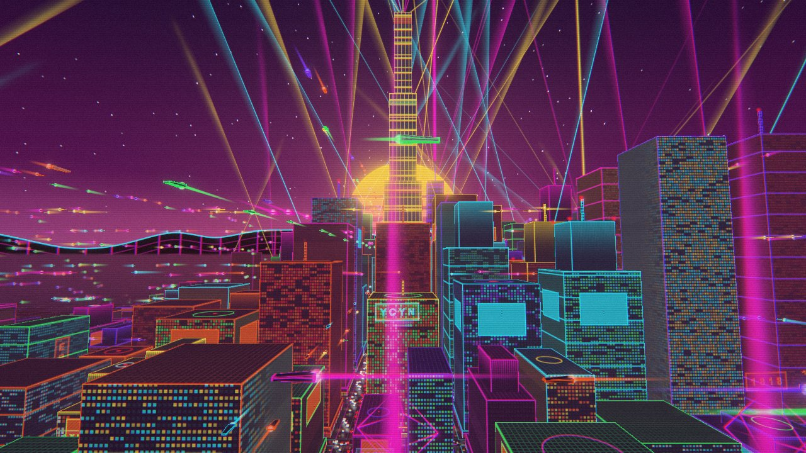

# Synthwave City 64k

An endless synthwave megacity you fly through, in **one HTML file of 17,208 bytes**: neon towers,
flying traffic, busy streets, wet roads, a striped sun, and two music tracks the city pulses to. There
is no server, install, library or asset file; everything is generated when the page runs, with WebGL2
and Web Audio. It rebuilds [Synthwave City](https://github.com/highsierralabs/Synthwave_City)
(three.js, about 980 kB) the way a demoscene 64k intro is built.



| | |
|---|---|
|  |  |
|  |  |

## Run it

**Play it in the browser:** <https://highsierralabs.github.io/Synthwave_City_html/> (the same file;
[`safe.html`](https://highsierralabs.github.io/Synthwave_City_html/safe.html) is the ASCII copy).

Or download [`docs/release/synthwave-city.html`](docs/release/synthwave-city.html) and open it in a
current Chrome or Edge: double-click it on a PC, or open it from the file manager on a phone. Click or
tap for sound. Move it as a file, never as pasted text: it is UTF-16 and pasting breaks it. If a
device shows text or nothing, use [`synthwave-city.safe.html`](docs/release/synthwave-city.safe.html)
(22,333 bytes, plain ASCII). A web server must send it as `text/html`.

## Controls

| Key | Does | Touch |
|---|---|---|
| (watch) | A drone tours the city without end | |
| drag | Look around; on the tour the view eases back when you let go | drag |
| `Space` | Free flight on or off | ▲ |
| `W` `A` `S` `D`, `Q` `E`, `Shift` | Fly, down and up, faster | one finger flies forward and steers; a second one goes faster |
| arrows, mouse wheel | Look, zoom | |
| `M` | Sound on or off | ♪ |
| `R` | Next of the two tracks | ♫ |
| `N` | Next mood: sunset, midnight, miami | ◐ |
| `1` `2` `3` | Quality (phones start at 1, desktops at 3) | HD |
| `F` | Fullscreen | □ |
| `H` | Hide the interface | |

## Status

Every feature that was built ships in this file. Versions cut down to 12,396 bytes still pass the
project's "still Synthwave City" checklist ([SIZE.md](SIZE.md)); the full build is the release.
Tested in Chromium on one Windows desktop and played by the operator with touch. Not tested: Firefox
and Safari. Details of what was and was not checked: [BUILD.md](BUILD.md).

## Build

Node 24 (`>=24.14.1 <25`).

```
npm ci
npm run build      # dist/synthwave-city.html and .safe.html
npm run check      # types, unit tests, import rules, plan ownership
```

[BUILD.md](BUILD.md) has the file format, the pipeline, every check and the measurements;
[architecture.md](architecture.md) the design; [Agents.md](Agents.md) how to work on it;
[plans/](plans/) each task with its evidence.

## Credits

[Synthwave City](https://github.com/highsierralabs/Synthwave_City) is the original and the reference
for the look. [Afterglow City](https://github.com/J-o-h-n-M/afterglow-city) by J-o-h-n-M and
[Abyssal Garden](https://github.com/Noniv/abyssal-garden) by Noniv, single-file WebGPU demos,
prompted doing it in one file; no code is taken from either. Built with TypeScript, esbuild, terser,
@gfx/zopfli, Vitest and Playwright.

## License

MIT, see [LICENSE](LICENSE).
